<!-- 本文件可直接在 GitHub 网页编辑，通过 GitHub Actions 自动导出 DOCX。-->

# 深度学习实验一

> NumPy 操作 · 正弦回归 · Softmax 手写数字识别

2026 · 基础实验与独立拓展研究

课程：深度学习 / 神经网络入门

| 个人信息（提交前填写） | 内容 |
| --- | --- |
| 点名册序号 | ________ |
| 班级（与点名册一致） | ____________________ |
| 12 位学号 | ____________________ |
| 姓名 | ____________________ |
| 实验平台 | Ubuntu · NVIDIA RTX 5090 D v2 · PyTorch 2.7.0 + CUDA 12.8 |

说明：此报告中的曲线、参数和指标均由本项目代码实际运行产生；拓展内容与作业必做部分明确区分。

## 一、实验目标与运行环境

本次实验掌握 NumPy 数组与索引、基于梯度下降的线性/多项式回归、MNIST 的 784→10 Softmax 线性分类。实验采用固定随机种子 2026，保留源代码、原始数据、训练日志与结果文件以便复现。

| 环境项目 | 实测配置 |
| --- | --- |
| Python | 3.11.16 |
| PyTorch | 2.7.0+cu128 |
| CUDA Runtime | 12.8 |
| 计算设备 | NVIDIA GeForce RTX 5090 D v2 |
| 随机种子 | 2026 |

## 二、NumPy 基本操作

操作步骤：导入 NumPy；建立一维与二维数组，检查 type / shape / 下标；生成全零、全一和单位矩阵；使用 arange 建立 12 元素数组，reshape 至 3×4 并执行行、列与负索引切片。以下是代码和真实输出的并排证据。

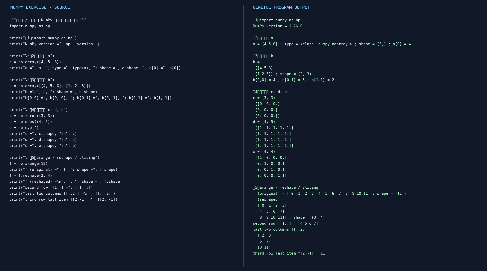

*图 1  NumPy 基础操作：实际源代码与终端输出*

重点结果：a.shape=(3,)，b.shape=(2,3)，reshape 后 f.shape=(3,4)；f[1,:]=[4,5,6,7]，f[:,2:] 为最后两列，f[2,-1]=11。所有完整可运行代码见 numpy_exercise.py。

## 三、回归任务：数据生成与模型训练

### 3.1 数据生成

100 个 x 在 [-3,3] 等距采样。目标 y=sin(x)+ε，ε 服从 [-0.5,0.5] 均匀分布。为保证两种模型公平比较，采用完全相同的带噪声样本，数据保存在 results/sine_training_data.csv。

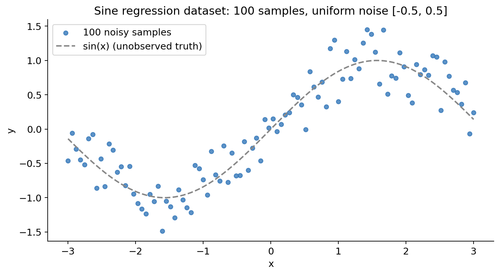

*图 2  正弦信号的 100 个带噪训练样本*

### 3.2 线性回归

模型：ŷ=wx+b；损失函数：MSE=Σ(ŷ−y)²/n。使用 PyTorch 的 nn.Linear(1,1)、MSELoss 和 Adam 优化器；依次执行清空梯度、前向传播、计算损失、反向传播和参数更新。

| 指标 | 实测结果 |
| --- | --- |
| w | 0.345843 |
| b | 0.018748 |
| 训练 MSE | 0.229903 |
| 参数更新次数 | 1500 |

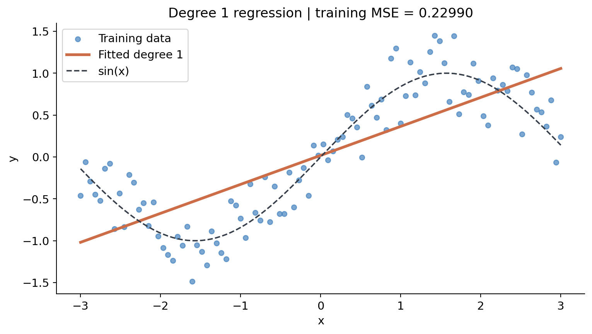

*图 3  线性回归拟合曲线与训练样本*

分析：直线只能刻画输入与输出之间的一阶趋势，无法适应正弦曲线的弯曲部分，属于模型表达能力限制导致的欠拟合；持续增加训练轮次无法根本消除这一结构性误差。

### 3.3 三次多项式线性回归

特征映射 φ(x)=[x,x²,x³]，模型 ŷ=w₁x+w₂x²+w₃x³+b。模型对参数仍为线性的，但扩展后的输入表达能力更强。

| 指标 | 实测结果 |
| --- | --- |
| w₁ | 0.866046 |
| w₂ | 0.009964 |
| w₃ | -0.094439 |
| b | -0.011748 |
| 训练 MSE | 0.071531 |
| 参数更新次数 | 2600 |

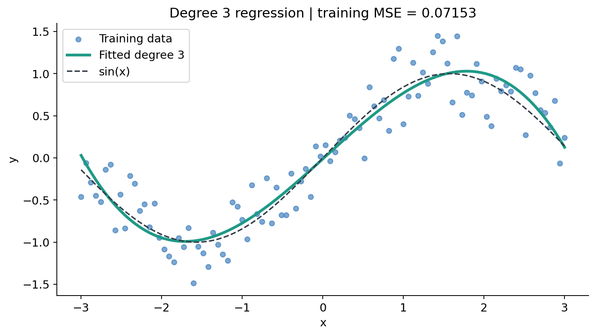

*图 4  三次多项式回归拟合曲线与训练样本*

在同一数据集上，MSE 从 0.229903 降至 0.071531，降低 68.9%。三次曲线能表现弯曲形状，但其结构不是正弦函数本身；噪声不可由数据中完全消除。

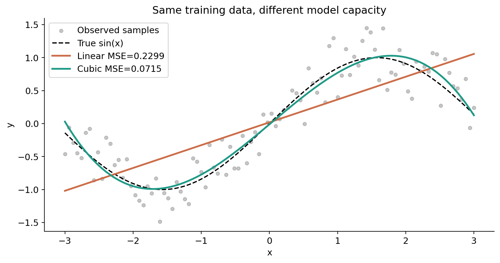

*图 5  模型表达能力对比*

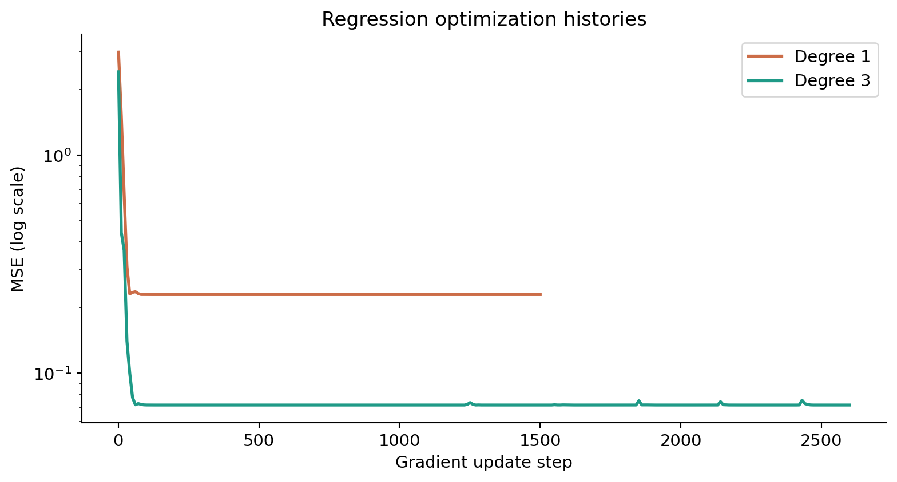

*图 6  两种模型优化过程中的 MSE 下降曲线*

核心实现步骤：固定种子→构造 x/y→根据模型生成 (100,1) 或 (100,3) 张量→实例化 Linear→MSELoss→Adam→每轮 zero_grad/backward/step→保存真实参数与预测图。

## 四、MNIST Softmax 分类

MNIST 包含 60,000 张训练图和 10,000 张测试图，每张灰度图为 28×28。输入张量展平为 784 维；基线模型只使用一层 nn.Linear(784,10)，不加入隐藏层或卷积层，严格对应作业 y=softmax(wx+b)。输出为 10 个类别 logits，CrossEntropyLoss 内部处理 log-softmax，因此训练时不手动调用 softmax。

| 核心指标 | 实测结果 |
| --- | --- |
| 模型可训练参数总量 | 7850 |
| 批大小 | 256 |
| 轮次 Epoch | 10 |
| 累计迭代 Iteration | 2350 |
| 最终训练准确率 | 91.91% |
| 最终测试准确率 | 92.07% |
| 最终训练平均交叉熵 | 0.28898 |
| 最终测试平均交叉熵 | 0.28486 |
| 优化器 | SGD (lr=0.2) |

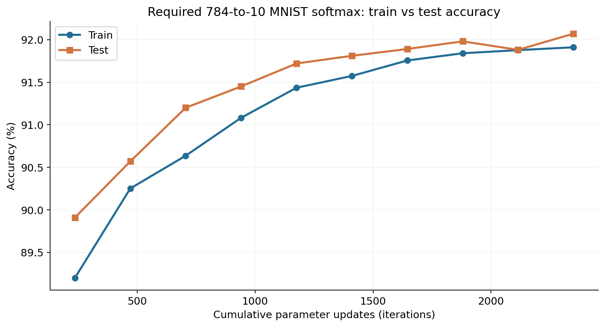

*图 7  随累计训练迭代数变化的训练/测试分类准确率*

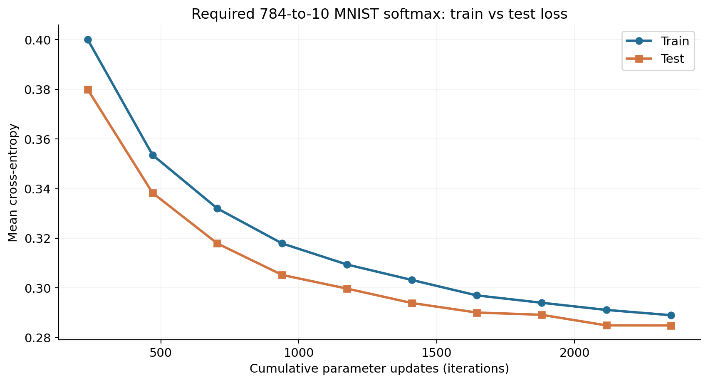

*图 8  随累计训练迭代数变化的训练/测试平均分类损失*

实现步骤：使用 torchvision 的 MNIST 原始分区；将 uint8 灰度图缩放至 [0,1]；以批为单位 shuffle 并训练；每完成一个 Epoch，在不更新参数的前提下分别评估全量训练集和测试集；将评估点放在累计梯度更新次数轴上，生成两张双曲线图。评估模式下使用 model.eval() 与 torch.inference_mode()，不执行 backward/step。

分析：准确率表示预测正确样本占比；交叉熵还反映预测概率的置信程度，两者并不必然同步变化。训练集指标与测试集指标存在差距，主要因为训练数据用于优化，而独立测试数据只用于评估泛化能力。

## 五、拓展实验（非作业必做项目）

### 5.1 自动求导的数值梯度验证

为核验 PyTorch 的反向传播机制，在独立的双精度小样本上比较 autograd(w) 与中心差分 [L(w+h)−L(w−h)]/(2h)。

| 项目 | 结果 |
| --- | --- |
| Autograd dL/dw | -0.9512666667 |
| 中心差分 dL/dw | -0.9512666667 |
| 相对误差 | 2.977e-13 |

二者高度一致，说明所设计算图及其求导方向得到了独立数值方法支持。

### 5.2 模型复杂度与分布外外推

| 多项式阶数 | 训练 MSE | 区间内对 sin(x) MSE | 区间外对 sin(x) MSE |
| --- | --- | --- | --- |
| 1 | 0.22990 | 0.16677 | 3.5655 |
| 3 | 0.07153 | 0.00464 | 3.1904 |
| 5 | 0.06584 | 0.00172 | 3.1552 |
| 9 | 0.05997 | 0.00752 | 5186.1034 |

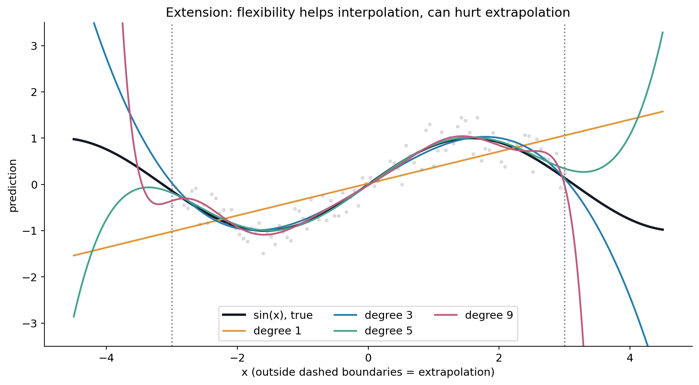

*图 9  不同次数多项式：区间内拟合与超出 [-3,3] 后的外推*

说明：此处不同阶数通过 NumPy 多项式最小二乘拟合，只用于研究，不替代必做的 PyTorch 三次回归。训练区间外，复杂多项式可能剧烈偏离真实正弦曲线，提示拟合训练数据与可靠泛化是两个不同问题。

### 5.3 错误结构、置信度与可解释性

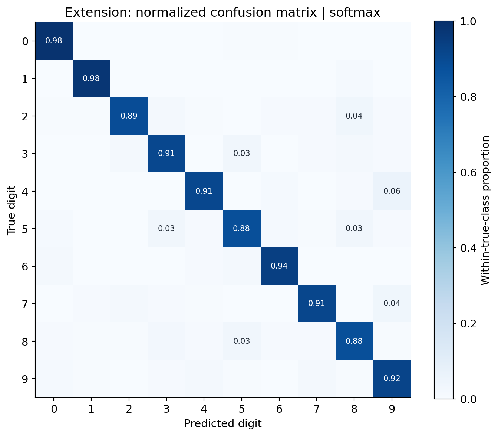

*图 10  Softmax 在独立测试集上的按真实类别归一化混淆矩阵*

较常见的错分方向（真实→预测）：4→9（58 个）；2→8（40 个）；7→9（38 个）。该分析帮助定位模型更难区分的笔画组合。

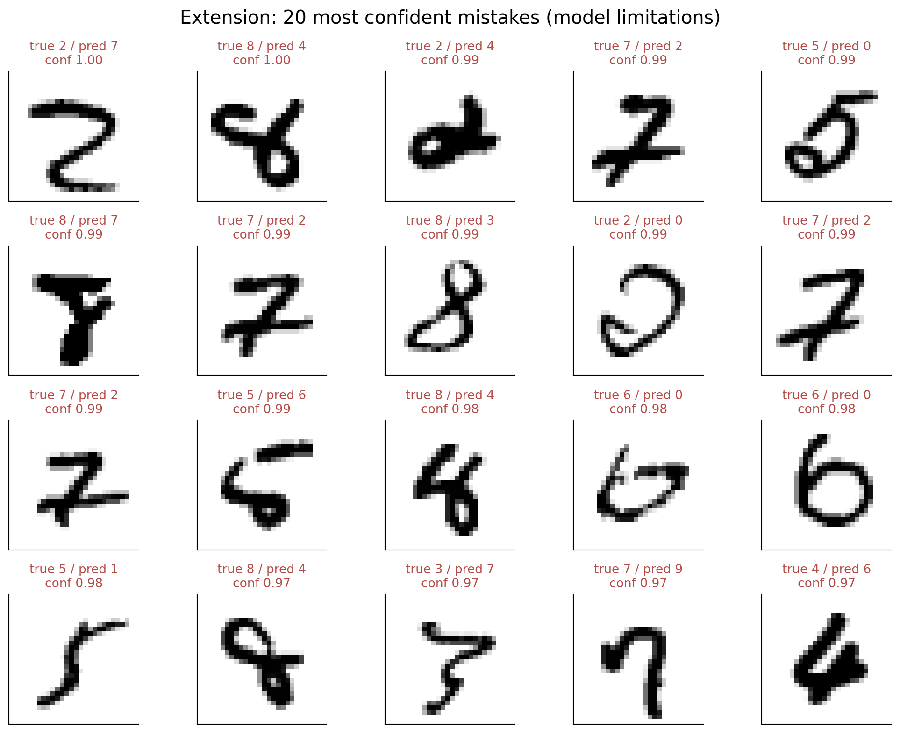

*图 11  模型置信度最高的 20 个错误预测*

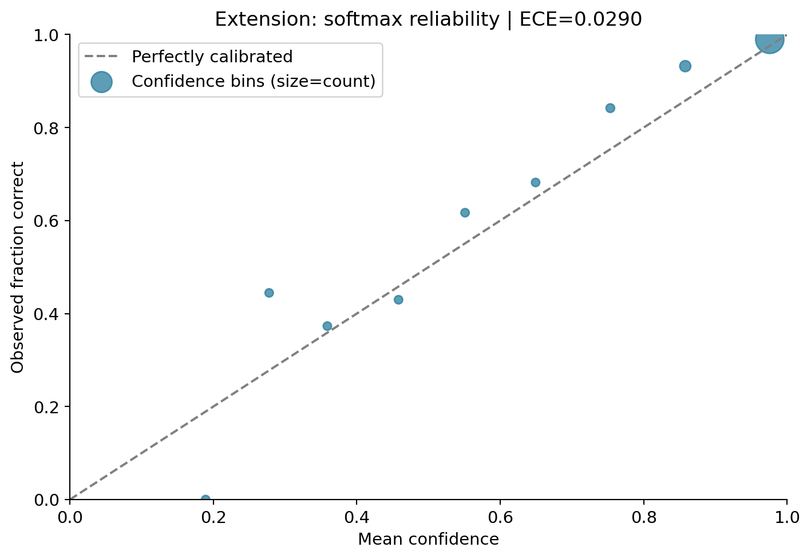

*图 12  置信度与实际正确频率之间的一致性*

10 等宽区间 Expected Calibration Error（ECE）=0.02899。准确率高并不代表概率可靠：模型对错题仍可能给出很高置信度。ECE 依赖分桶方式，因此作为诊断而不是绝对评分。

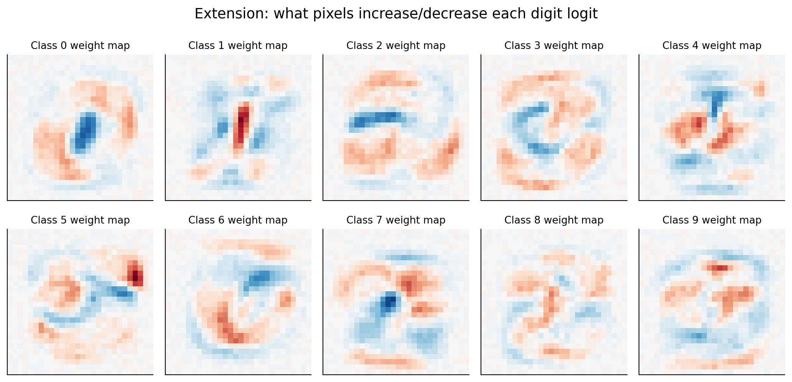

*图 13  十个类别的线性权重空间热力图*

每张权重图将 Linear(784,10) 中对应类别的 784 个像素权重重排为 28×28。红色与蓝色分别表示对该类别 logit 的正负影响，这些图不是模型生成的手写数字，也不能直接解释输入像素间的非线性交互。

### 5.4 额外模型：CNN 与线性分类器对比

| 属性 | Softmax 基线 | 独立 CNN 拓展 |
| --- | --- | --- |
| 测试准确率 | 92.07% | 97.72% |
| 测试平均交叉熵 | 0.28486 | 0.07842 |
| 参数量 | 7850 | 105866 |
| 训练 Epoch | 10 | 3 |

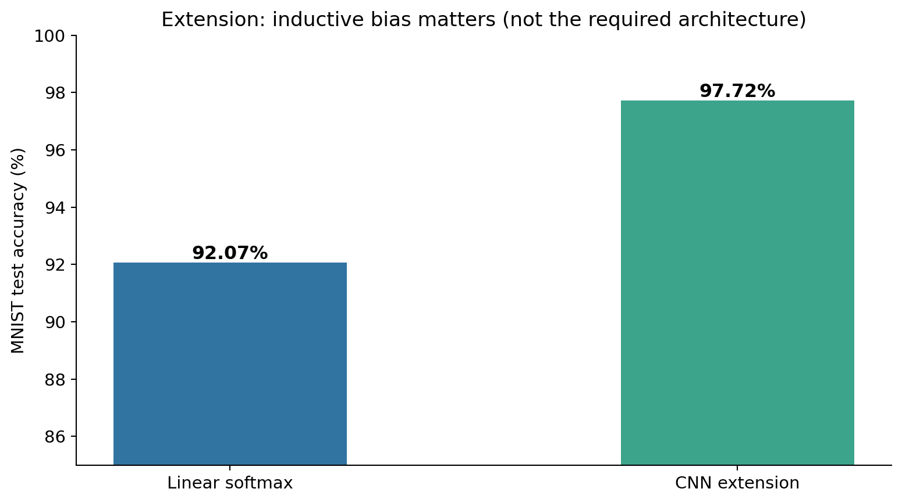

*图 14  两类模型的测试准确率对比（训练轮次不同，非严格公平基准）*

CNN 利用局部卷积及池化的结构先验来捕获笔画形状。两模型训练轮次和优化器不同，因此对比仅用于启发：不能将所有性能差异归因于网络结构。必做模型依然是 784→10 的线性 Softmax。

## 六、实验结论与反思

本实验从形状操作开始，建立了数据→特征→预测→损失→梯度→参数更新→独立测试的完整实践链。线性回归揭示表达能力不足的欠拟合，三次特征映射解释非线性特征与线性模型的区别；MNIST 通过 784×10 权重将图像映射到十类别分数，交叉熵指导参数更新。拓展实验进一步提醒：低训练误差不等于外推可靠，高分类准确率也不意味着置信度充分可信。

## 七、复现方法与文件清单

    cd ~/Desktop/NN_Experiment_1_2026

    python run_all.py --device cuda

    python create_report.py

关键文件：numpy_exercise.py（所有 NumPy 必做步骤）；run_all.py（训练、评估、图表与拓展）；results/metrics.json（原始指标）；results/training.log（实际训练记录）；results/softmax_weights.pt（模型权重）；figures/（各图）；README.md（复现与提交说明）。

原始实验要求：https://github.com/caixd-220529/deel_learning_2026-public/blob/main/experiments/exp1/实验一.md

正式提交前：填写点名册序号、班级全称、12 位学号、姓名；核对截止时间；依教师规范改名为 序号-班级-学号-姓名-exp1-v1.docx。
